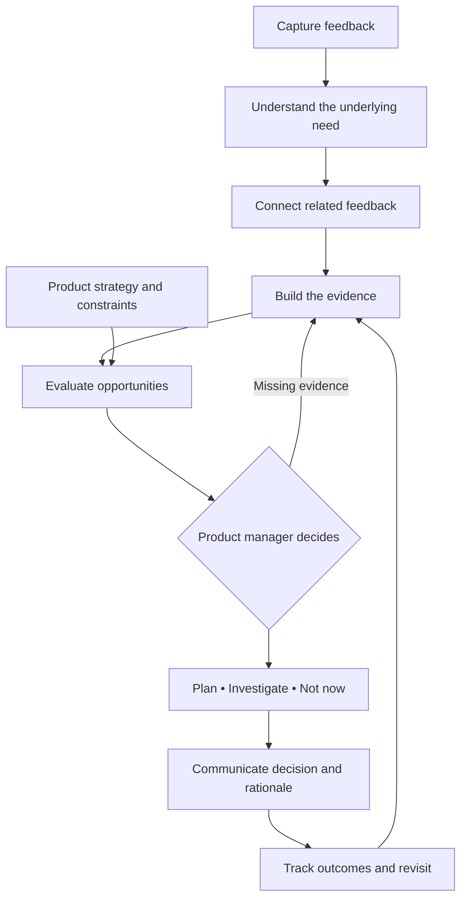

# Feature intelligence: from feedback to decisions

Primary user: a product manager reviewing feedback from multiple stakeholders.
Business objective: improve the evidence available for product decisions while reducing manual triage effort.

## Stage responsibilities

1. **Capture:** preserve the submitted title and description, authenticated submitter, workspace and submission time.
2. **Understand:** AI proposes the underlying need and flags ambiguous interpretation.
3. **Connect:** AI finds duplicates and related-but-distinct requests, retaining the originals.
4. **Build evidence:** assemble affected customers, frequency, severity, workarounds, business impact and missing information.
5. **Evaluate:** compare evidence with human-supplied strategy and constraints. Unknown impact or effort remains unknown.
6. **Decide:** a product manager accepts, investigates or defers an opportunity, recording their rationale.
7. **Communicate and learn:** make decisions visible and revisit them as new evidence or outcomes arrive.

## Implementation boundary

Workspace members can browse and support requests; admins and editors can capture feedback and review evidence. AI suggestions can identify the underlying need, propose grouping, compare opportunities, and draft a submitter update. Reviewers decide what to approve, plan, and publish. When a reviewer asks for clarification, the submitter can reply in Updates and the request returns to New with the original text preserved. Shipped opportunities can record an outcome backed by a short note or link.

PostgreSQL row-level security enforces workspace membership and message visibility. This is an authenticated workspace workflow with in-app delivery; it does not include a public customer portal or email delivery.

## Proposed success metrics

- Median time to triage a request.
- Percentage of grouping proposals accepted without correction.
- Incorrect duplicate recommendations on a labeled evaluation set.

These are measurement targets, not achieved results.
